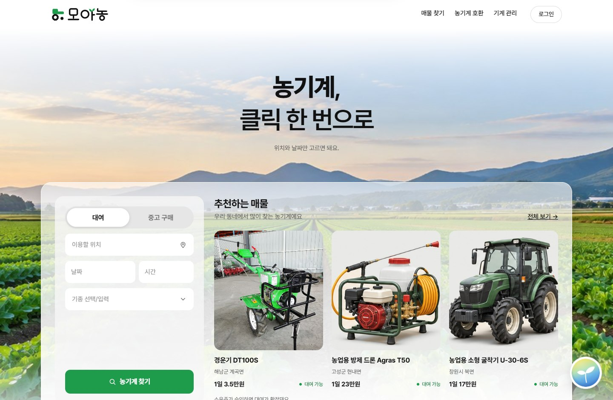
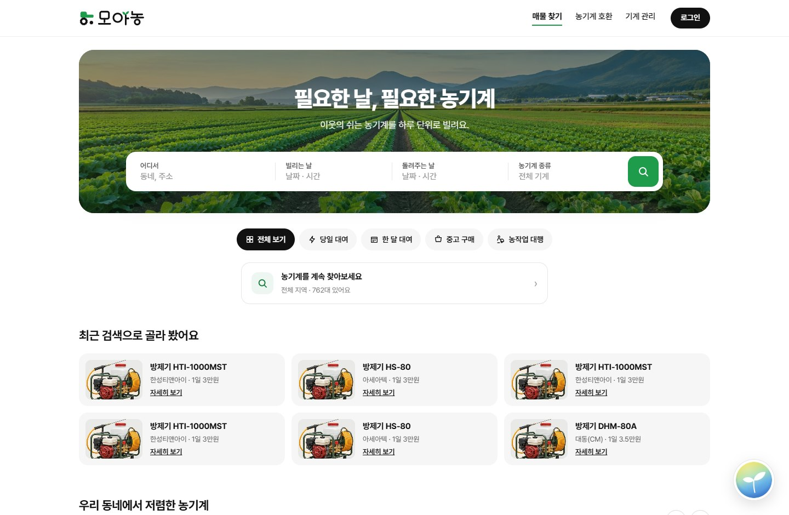
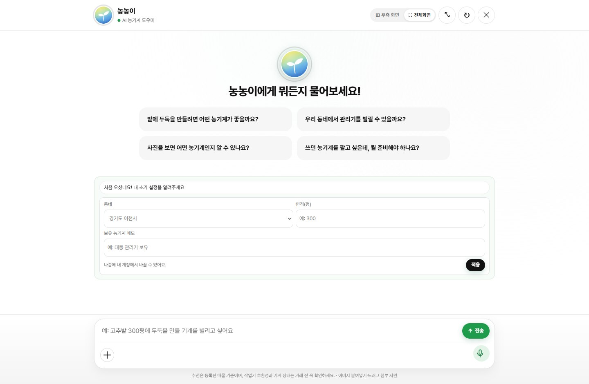
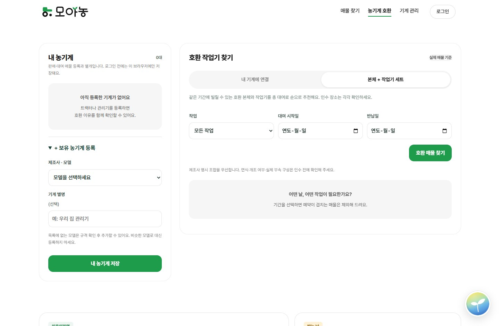

# 모아농

**무슨 기계를 빌려야 할지 모를 때, 하려는 농작업부터 알려 주세요.**  
내 밭에 맞는 농기계를 찾고, 이웃 농가의 대여·판매 매물을 비교하는 서비스입니다.

[매물 찾기](#매물-찾기) · [농농이 상담](#농농이-상담) · [농기계 호환 확인](#농기계-호환-확인)

## 프로젝트 개요

고추밭에 비닐을 씌우려는 농부는 할 일을 알아도 어떤 기계를 찾아야 할지 막막합니다. 필요한 작업기를 찾아도 내 관리기에 연결할 수 있는지, 며칠만 빌리면 얼마인지 따로 알아봐야 합니다. 모아농은 이런 질문에서 출발해 농작업 상담과 동네 매물 찾기를 한곳에 모았습니다.

| 이용자 | 모아농에서 할 수 있는 일 |
| --- | --- |
| 처음 농사를 짓는 사람 | 작물과 하려는 일을 설명하고 알맞은 기계를 추천받습니다. |
| 농기계를 빌리거나 사려는 농가 | 필요한 날짜와 지역에 맞춰 대여료나 판매가를 비교합니다. |
| 기계를 보유한 농가 | 보유 기계에 맞는 작업기를 찾거나, 쉬고 있는 기계를 매물로 등록합니다. |

## 매물 찾기

대여 시작일과 반납일을 정하고 동네 매물을 둘러봅니다. 매물에서 기종과 가격을 비교하고, 상세 화면에서 대여 기간과 총대여료를 확인한 뒤 요청을 보낼 수 있습니다. 구매를 고려하는 기계는 찜 목록에 담아 다시 살펴볼 수 있습니다.

*시연용 매물은 10개 기종의 대여 60건과 판매 40건입니다. 가격, 점검일, 예약 일정과 지도 거리는 예시입니다.*

## 농농이 상담

> “고추밭 300평에 두둑을 만들려고 해요. 하루 10만 원 안으로 빌릴 수 있을까요?”

농농이에게 글이나 음성으로 물어보세요. 작물, 작업, 면적, 예산을 바탕으로 필요한 조건을 되묻고 등록된 매물에서 후보를 찾아줍니다. 대여할 기계를 정했다면 대화에서 기간과 비용을 확인하고 대여 요청까지 이어갈 수 있습니다.

## 농기계 호환 확인

트랙터나 관리기가 있다면 **내 기계에 연결**에서 보유 모델을 기준으로 작업기를 찾습니다. 기계를 처음 빌린다면 **본체 + 작업기 세트**에서 작업과 대여 기간을 골라 함께 쓸 수 있는 조합을 확인합니다.
