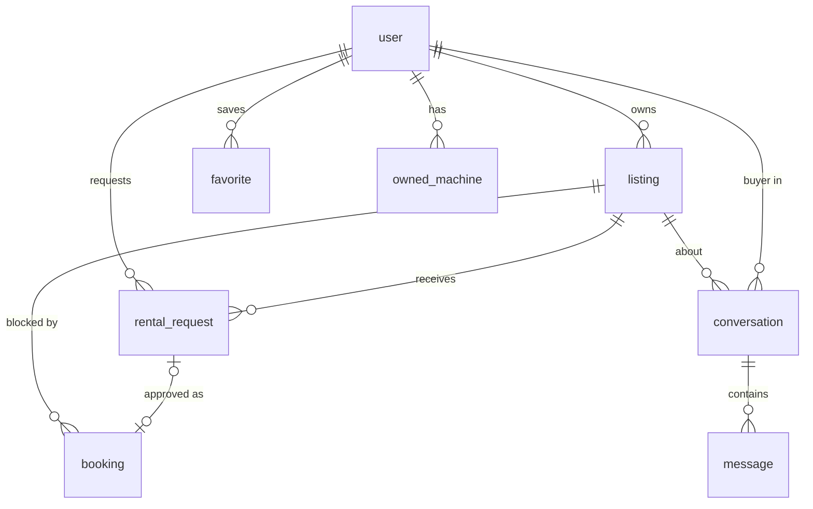
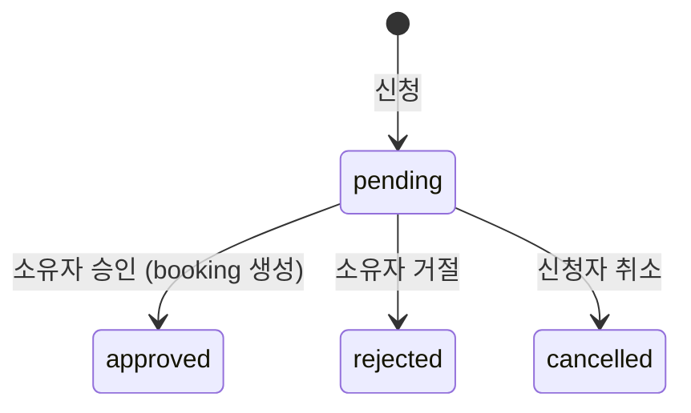

# 서버 데이터 설계: 매물·소유권·대여 신청

상태: 제안. 리뷰를 거쳐 9장의 순서대로 구현 PR을 낸다.
기준 커밋: `b6a90b0` (2026-11-07). 이 문서는 코드를 바꾸지 않는다.

## 1. 목표와 범위

지금은 대여 요청, 채팅, 찜, 보유 농기계가 브라우저 `localStorage`에만 있다. 그래서 신청자가 보낸 요청을 소유자가 다른 기기에서 볼 수 없고, 같은 브라우저를 쓰는 계정끼리 데이터가 섞인다. 소유자 판별도 화면에서 이메일 문자열을 비교한다(`src/main.js` `getOwnerData`).

이 문서는 데모를 여러 사용자가 쓰는 서비스로 바꾸는 데 필요한 다음 내용을 정한다.

- 테이블과 제약 조건
- 누가 무엇을 할 수 있는지, 서버에서 어떻게 검사하는지
- 대여 신청·승인 흐름과 이중 예약 방지
- API 목록
- 로컬 개발 DB
- 기존 브라우저 데이터 처리
- 구현 순서

다루지 않는 것: 결제, 알림, 실제 거리 계산, 판매 거래 절차의 세부 사항.

## 2. 현재 브라우저 저장 데이터와 옮길 곳

| 저장 위치 | 내용 | 현재 쓰임 | 옮길 곳 |
| --- | --- | --- | --- |
| `moa-farm-v1`.`requests` | `{id, listingId, start, end, note, status}`. 신청자 정보 없음 | 대여 신청 폼에서 추가(`main.js:1030`) | `rental_request` |
| `moa-farm-v1`.`messages` | `{id, listingId, role, text}`. 어느 구매자와의 대화인지 구분 없음 | 채팅 폼에서 추가(`main.js:1071`) | `conversation` + `message` |
| `moa-farm-v1`.`favorites` | 매물 ID 목록 | 찜 버튼 | `favorite` |
| `moa-farm-v1`.`customListings` | 직접 등록한 매물. 사진은 data URL | 등록 폼 `openNewListing()`을 화면에서 부르지 않아 새로 생기지 않는다. 예전 버전 데이터만 남아 있을 수 있다 | `listing` |
| `moa-farm-v1`.`statuses` | 매물 상태 덮어쓰기 | 읽기만 하고 쓰는 곳이 없다 | `listing.status` |
| `moa-farm-v1`.`bookings` | 추가 예약 기간 | 읽기만 하고 쓰는 곳이 없다 | `booking` |
| `moa-farm-v1`.`aiSummaries` | AI 한줄 요약 | 추천 결과 캐시 | 브라우저에 그대로 둔다 |
| `moa-farm-v1`의 `view`, `filters`, `region`, `sort` 등 | 화면 상태 | | 브라우저에 그대로 둔다 |
| `moa-owner-db-v1` | `10jo` 계정용 소유자 데이터 사본 | 소유자 화면 | 없앤다. `listing.owner_id`로 대신한다 |
| `moa-owned-machines-v1` (`garage.js`) | 보유 농기계 `{id, modelId, name}` | 내 농기계 | `owned_machine` |
| 메모리 `demoRentedIds` | 해시로 고른 매물을 오늘부터 '대여 중'으로 표시 | 시연용 | 시드 `booking`으로 바꾼다 |

서버 시드 데이터는 매물 100개다. 그중 `r1`, `s1`이 `owner: true`(10jo 소유)이고, 예약된 기간이 13건 있으며, 상태는 모두 `open`이다.

## 3. 테이블

계정은 지금처럼 better-auth가 관리한다. 아래 테이블은 better-auth가 만드는 `"user"`(`id TEXT`)를 참조하므로 **계정과 같은 Postgres에 둔다.**



```sql
CREATE EXTENSION IF NOT EXISTS btree_gist;

CREATE TABLE listing (
  id            TEXT PRIMARY KEY,
  owner_id      TEXT NOT NULL REFERENCES "user"(id),
  type          TEXT NOT NULL CHECK (type IN ('rent', 'sale')),
  title         TEXT NOT NULL CHECK (char_length(title) BETWEEN 1 AND 80),
  brand         TEXT NOT NULL,
  machine_type  TEXT NOT NULL,
  model_id      TEXT,
  crop_ids      TEXT[] NOT NULL CHECK (cardinality(crop_ids) > 0),
  operations    TEXT[] NOT NULL CHECK (cardinality(operations) > 0),
  area_min      INTEGER NOT NULL CHECK (area_min > 0),
  area_max      INTEGER NOT NULL CHECK (area_max >= area_min),
  price         INTEGER NOT NULL CHECK (price >= 0),
  region        TEXT NOT NULL,
  condition     TEXT NOT NULL CHECK (condition IN ('good', 'used', 'repair')),
  inspected_at  DATE NOT NULL,
  included      TEXT NOT NULL DEFAULT '',
  pickup        TEXT NOT NULL DEFAULT '',
  description   TEXT NOT NULL DEFAULT '',
  summary       TEXT NOT NULL DEFAULT '',
  photo_url     TEXT,
  status        TEXT NOT NULL DEFAULT 'open' CHECK (status IN ('open', 'dealing', 'done', 'hidden')),
  is_demo       BOOLEAN NOT NULL DEFAULT false,
  created_at    TIMESTAMPTZ NOT NULL DEFAULT now(),
  updated_at    TIMESTAMPTZ NOT NULL DEFAULT now()
);
CREATE INDEX listing_owner_idx ON listing (owner_id);
CREATE INDEX listing_browse_idx ON listing (type, status);

CREATE TABLE rental_request (
  id            UUID PRIMARY KEY DEFAULT gen_random_uuid(),
  listing_id    TEXT NOT NULL REFERENCES listing(id) ON DELETE CASCADE,
  requester_id  TEXT NOT NULL REFERENCES "user"(id) ON DELETE CASCADE,
  start_date    DATE NOT NULL,
  end_date      DATE NOT NULL CHECK (end_date >= start_date),
  note          TEXT NOT NULL DEFAULT '' CHECK (char_length(note) <= 500),
  status        TEXT NOT NULL DEFAULT 'pending'
                CHECK (status IN ('pending', 'approved', 'rejected', 'cancelled')),
  decided_at    TIMESTAMPTZ,
  created_at    TIMESTAMPTZ NOT NULL DEFAULT now()
);
CREATE INDEX rental_request_listing_idx ON rental_request (listing_id, status);
CREATE INDEX rental_request_requester_idx ON rental_request (requester_id, created_at DESC);
CREATE UNIQUE INDEX rental_request_pending_once
  ON rental_request (listing_id, requester_id, start_date, end_date) WHERE status = 'pending';

CREATE TABLE booking (
  id          UUID PRIMARY KEY DEFAULT gen_random_uuid(),
  listing_id  TEXT NOT NULL REFERENCES listing(id) ON DELETE CASCADE,
  request_id  UUID UNIQUE REFERENCES rental_request(id),
  period      DATERANGE NOT NULL CHECK (NOT isempty(period)),
  created_at  TIMESTAMPTZ NOT NULL DEFAULT now(),
  CONSTRAINT booking_no_overlap EXCLUDE USING gist (listing_id WITH =, period WITH &&)
);

CREATE TABLE conversation (
  id          UUID PRIMARY KEY DEFAULT gen_random_uuid(),
  listing_id  TEXT NOT NULL REFERENCES listing(id) ON DELETE CASCADE,
  buyer_id    TEXT NOT NULL REFERENCES "user"(id) ON DELETE CASCADE,
  created_at  TIMESTAMPTZ NOT NULL DEFAULT now(),
  UNIQUE (listing_id, buyer_id)
);

CREATE TABLE message (
  id               UUID PRIMARY KEY DEFAULT gen_random_uuid(),
  conversation_id  UUID NOT NULL REFERENCES conversation(id) ON DELETE CASCADE,
  sender_id        TEXT NOT NULL REFERENCES "user"(id) ON DELETE CASCADE,
  body             TEXT NOT NULL CHECK (char_length(body) BETWEEN 1 AND 500),
  created_at       TIMESTAMPTZ NOT NULL DEFAULT now()
);
CREATE INDEX message_conversation_idx ON message (conversation_id, created_at);

CREATE TABLE favorite (
  user_id     TEXT NOT NULL REFERENCES "user"(id) ON DELETE CASCADE,
  listing_id  TEXT NOT NULL REFERENCES listing(id) ON DELETE CASCADE,
  created_at  TIMESTAMPTZ NOT NULL DEFAULT now(),
  PRIMARY KEY (user_id, listing_id)
);

CREATE TABLE owned_machine (
  id          UUID PRIMARY KEY DEFAULT gen_random_uuid(),
  user_id     TEXT NOT NULL REFERENCES "user"(id) ON DELETE CASCADE,
  model_id    TEXT NOT NULL,
  name        TEXT NOT NULL CHECK (char_length(name) BETWEEN 1 AND 40),
  created_at  TIMESTAMPTZ NOT NULL DEFAULT now()
);
CREATE INDEX owned_machine_user_idx ON owned_machine (user_id);
```

설계 메모:

- **`owner INTEGER(0/1)` 대신 `owner_id`를 둔다.** "내 매물" 여부는 `owner_id = 세션 사용자`로 정한다.
- **매물 ID는 기존 값(`r1`, `mock-…`)을 그대로 쓴다.** 그래야 찜 목록과 모델 사양 연결(`machine-specifications.js`)이 유지된다. 새 매물은 UUID 문자열로 만든다.
- **`crop_ids`, `operations`는 배열로 저장한다.** 검색할 때 `&&`, `@>` 연산자로 거를 수 있다.
- **예약 기간은 `daterange(start, end, '[]')`로 저장한다.** 지금 코드의 `{start, end}`가 양 끝 날짜를 모두 포함하는 의미(`available()`)와 같다. 11-20~11-22 예약 뒤에 11-23부터 빌리는 요청은 겹치지 않는다.
- **`booking_no_overlap` 제약으로 이중 예약을 막는다.** 같은 매물에 기간이 겹치는 예약을 DB가 직접 거부하므로, 승인이 동시에 들어와도 이중 예약이 생기지 않는다. 시드 예약과 소유자가 직접 막은 기간은 `request_id`를 NULL로 둔다.
- **`rental_request_pending_once`는 반복 클릭을 막는다.** 같은 사람이 같은 매물·기간으로 대기 요청을 두 번 만들 수 없다.
- **사진은 `photo_url`만 저장한다.** 지금처럼 data URL을 DB에 넣지 않는다. 파일을 어디에 저장할지는 10장 열린 질문 3번이다.
- **시드 소유자**: `r1`, `s1`은 10jo 계정에 둔다. 나머지 98개는 로그인할 수 없는 시스템 사용자(`demo-owner`, 이름 "데모 농가")에게 두고 `is_demo = true`로 표시한다. 이 98개에 들어온 신청을 어떻게 처리할지는 열린 질문 4번이다.

## 4. 권한 규칙

원칙: **브라우저가 보낸 소유자·신청자 ID는 쓰지 않는다.** 항상 세션에서 꺼낸 사용자 ID를 쓰고, 권한 조건은 `WHERE`절에 넣는다. 남의 데이터를 요청하면 존재 여부도 드러나지 않게 404를 돌려준다.

| 동작 | 누가 | 서버 검사 |
| --- | --- | --- |
| 매물 목록·상세 조회 | 누구나 | `status <> 'hidden'` |
| 매물 등록 | 로그인 사용자 | `owner_id`를 세션 사용자로 설정한다. 본문 값은 무시한다 |
| 매물 수정·상태 변경 | 소유자 | `WHERE id = $1 AND owner_id = 세션` |
| 대여 신청 | 로그인 사용자. 소유자 본인은 제외 | 대여 매물이고 `open`이며 수리 중이 아닐 것, 시작일이 오늘(KST) 이후일 것, 겹치는 예약이 없을 것 |
| 내 신청 목록 | 신청자 | `requester_id = 세션` |
| 받은 신청 목록 | 소유자 | `listing.owner_id = 세션` |
| 승인·거절 | 소유자 | 5장의 트랜잭션 |
| 신청 취소 | 신청자 | `pending`일 때만 `cancelled`로 바꾼다. 승인 후 취소는 열린 질문 2번 |
| 채팅 읽기·쓰기 | 해당 구매자, 매물 소유자 | `conversation.buyer_id = 세션 OR listing.owner_id = 세션` |
| 찜, 보유 농기계 | 본인 | `user_id = 세션` |

소유자 화면은 이메일을 비교하지 않고 `GET /api/listings?owner=me`의 결과로 그린다.

## 5. 신청과 승인 흐름



**신청.** 신청할 때 겹치는 예약을 확인한다. 하지만 아직 예약을 잡지는 않으므로, 서로 기간이 겹치는 대기 요청 여러 개가 함께 있을 수 있다. 최종 확정은 승인할 때 한다.

```sql
INSERT INTO rental_request (listing_id, requester_id, start_date, end_date, note)
SELECT l.id, $2, $3, $4, $5
FROM listing l
WHERE l.id = $1 AND l.type = 'rent' AND l.status = 'open' AND l.condition <> 'repair'
  AND l.owner_id <> $2
  AND NOT EXISTS (
    SELECT 1 FROM booking b
    WHERE b.listing_id = l.id AND b.period && daterange($3::date, $4::date, '[]'))
ON CONFLICT (listing_id, requester_id, start_date, end_date) WHERE status = 'pending' DO NOTHING
RETURNING id;
```

행이 반환되지 않으면 이유를 다시 조회해서 응답을 정한다. 매물이 없으면 404, 기간이 겹치면 409, 같은 대기 요청이 이미 있으면 그 요청을 돌려준다.

**승인.** 한 트랜잭션 안에서 처리한다.

```sql
BEGIN;
SELECT r.id, r.status, r.listing_id, r.start_date, r.end_date
FROM rental_request r JOIN listing l ON l.id = r.listing_id
WHERE r.id = $1 AND l.owner_id = $2 AND l.type = 'rent'
FOR UPDATE OF r;
-- 행 없음 → ROLLBACK, 404
-- status = 'approved' → ROLLBACK, 200 (반복 클릭)
-- status가 rejected/cancelled → ROLLBACK, 409
INSERT INTO booking (listing_id, request_id, period)
VALUES ($listing_id, $1, daterange($start_date, $end_date, '[]'));
-- 오류 23P01(exclusion_violation) → ROLLBACK, 409 "이미 예약된 기간"
UPDATE rental_request SET status = 'approved', decided_at = now() WHERE id = $1;
COMMIT;
```

- **반복 클릭**: `FOR UPDATE`가 같은 요청에 대한 승인을 하나씩 처리한다. 두 번째 승인은 이미 `approved`인 상태를 보고 200을 돌려준다. `booking.request_id UNIQUE`가 한 번 더 막는다.
- **다른 요청 동시 승인**: 두 승인이 동시에 예약을 넣으면, 뒤의 것이 앞 트랜잭션이 끝날 때까지 기다렸다가 `23P01`로 실패한다. 실패하면 전체를 되돌리므로 그 요청은 `pending`으로 남는다.
- **거절**: 같은 잠금을 잡은 뒤 `pending`일 때만 `rejected`로 바꾼다.

## 6. API

| 메서드·경로 | 용도 |
| --- | --- |
| `GET /api/listings` | 공개 목록(현재 API 유지). `?owner=me`는 내 매물 |
| `POST /api/listings` | 매물 등록 |
| `PATCH /api/listings/:id` | 매물 수정·상태 변경 |
| `POST /api/requests` | 대여 신청 |
| `GET /api/requests?role=requester\|owner` | 내 신청 / 받은 신청 |
| `POST /api/requests/:id/approve`, `/reject`, `/cancel` | 상태 변경 |
| `GET/POST /api/conversations`, `GET/POST /api/conversations/:id/messages` | 채팅 |
| `GET/PUT/DELETE /api/favorites/:listingId` | 찜 |
| `GET/POST/DELETE /api/owned-machines` | 보유 농기계 |

모든 쓰기 요청은 `/api/account`와 같은 규칙을 따른다. Origin을 확인하고, `application/json`만 받고, 본문 크기를 제한한다. 경로는 Vercel 파일 라우팅(`api/requests/[id]/approve.js`)을 쓴다. 로컬 개발 서버는 #18부터 `api/*.js` 핸들러를 그대로 실행한다. 새 API를 추가하면 `dev-server.js`의 라우팅 표에도 등록하고, `[id]` 같은 경로 변수를 처리하는 부분을 더한다.

## 7. 로컬 개발 DB

지금은 매물을 SQLite(Vercel에서는 메모리, 로컬은 파일)에, 계정은 로컬 SQLite 파일에 저장한다. 그런데 위 설계는 Postgres에만 있는 기능(`EXCLUDE` 제약, `daterange`, 배열 컬럼)을 쓰고, 계정 테이블을 외래 키로 참조한다. 두 DB를 따로 두면 외래 키를 걸 수 없다.

| 방식 | 장점 | 단점 |
| --- | --- | --- |
| **A. PGlite** (npm 패키지로 설치하는 내장 Postgres) | 설치할 것이 없다. 운영과 같은 SQL을 쓴다. 테스트도 같은 DB로 돌린다 | better-auth와 연결하려면 커뮤니티 Kysely 방언(`kysely-pglite-dialect`)이 필요하다 |
| B. Docker Postgres | 운영과 완전히 같다 | 개발자마다 Docker가 있어야 한다 |
| C. SQLite 유지 | 바꿀 것이 적다 | SQL을 두 벌 관리해야 하고, 이중 예약 방지를 앱 코드로 따로 짜야 한다 |

A를 권한다. A가 막히면 B로 간다. 이 설계의 SQL은 PGlite(Postgres 18.6, `btree_gist` 확장 포함)에서 그대로 실행되는 것을 확인했다.

## 8. 기존 데이터 처리

- **옮기지 않는 것**: 브라우저의 대여 요청, 메시지, 직접 등록 매물. 신청자 정보가 없어서 누구의 데이터인지 알 수 없고, 어차피 시연 데이터다. 새 버전을 처음 실행할 때 해당 키를 지우고 안내를 한 번 보여준다.
- **찜과 보유 농기계**: 로그인하지 않은 사용자는 지금처럼 브라우저에 둔다. 로그인하면 한 번 서버로 합치고 브라우저에서 지운다(열린 질문 6번).
- **로그아웃할 때**: 지금은 `state`를 비우지 않아 다음 사용자에게 데이터가 보인다. 로그아웃하면 사용자 데이터를 메모리와 저장소에서 지운다.

## 9. 구현 순서

1. **기반 정리**: 스키마 마이그레이션 스크립트, 시드(`demo-owner`, 시드 예약 포함), 로컬 PGlite, 스키마 테스트. (개발 서버 핸들러 공유는 #18에서 끝냈다.)
2. **매물**: 조회를 Postgres로 옮기고, 소유자 등록·수정 API를 만든다. 소유자 화면을 `owner=me`로 바꾸고 `moa-owner-db-v1`을 없앤다.
3. **신청·승인**: 신청, 승인, 거절, 취소 API를 만든다. 동시 승인과 반복 클릭 테스트를 포함한다.
4. **화면 연결**: 신청 폼, 내 대여 요청, 소유자 요청 목록을 API에 연결한다. 로그아웃 정리, localStorage 키 정리, 안내 문구 복구("준비 중" 제거)도 이 단계에서 한다.
5. **채팅, 찜, 보유 농기계.**
6. **나머지 정리**: 추천 후보 선정을 서버 한 곳으로 모으고, `main.js`를 나눈다.

## 10. 열린 질문

1. 한 요청을 승인할 때, 기간이 겹치는 다른 대기 요청을 그대로 둘까(소유자가 승인하려 하면 409), 자동으로 거절할까?
2. 승인된 대여를 취소할 수 있게 할까? 누가, 언제까지?
3. 사진은 어디에 저장할까? 예: Vercel Blob. 아니면 처음에는 사진 없이 시작할까?
4. 시연 매물 98개(`demo-owner`)에 들어온 신청은 "시연 매물은 승인되지 않음"으로 표시할까, 아니면 모두 10jo 소유로 바꿔 승인 시연에 쓸까?
5. 로컬 DB는 PGlite와 Docker 중 무엇으로 할까?
6. 로그인하지 않은 사용자의 찜·보유 농기계: 로그인할 때 합칠까, 로그인을 필수로 할까?
7. 판매 매물의 `dealing`·`done` 상태는 누가, 언제 바꿀까?

## 부록: 검증

3장과 5장의 SQL은 다음 두 환경에서 실행해 확인했다. 검증 스크립트는 저장소에 넣지 않았고, 1단계 PR에서 테스트로 옮긴다.

- **PGlite (Postgres 18.6)**
  - 시드 예약과 겹치는 신청은 만들어지지 않는다(끝 날짜 포함). 소유자 본인은 신청할 수 없다. 같은 대기 요청을 두 번 만들 수 없다.
  - 소유자가 아니면 승인할 때 404를 받는다. 반복 승인은 200이다. 겹치는 요청을 승인하면 409를 받고, 그 요청은 `pending`으로 남는다.
  - 붙어 있는 기간(11-22에 끝나는 예약 뒤 11-23 시작)은 승인된다.
- **실제 Postgres 18.6, 연결 20개**
  - 기간이 겹치는 요청 20건을 동시에 승인하면 정확히 1건만 승인되고 19건은 409를 받는다. 예약은 1건만 생긴다.
  - 같은 요청을 동시에 10번 승인하면 1번만 처리되고 9번은 반복 처리(200)된다. 예약은 1건만 생긴다.
